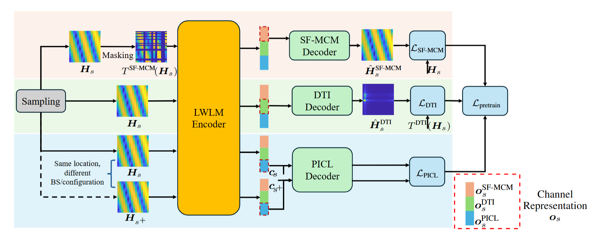
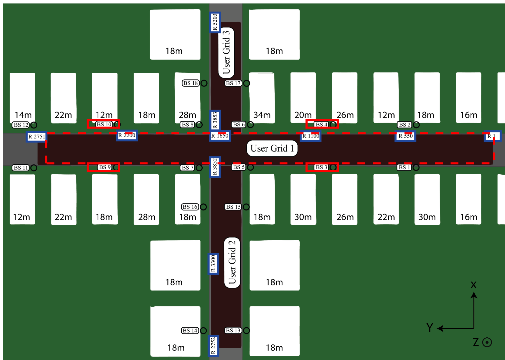
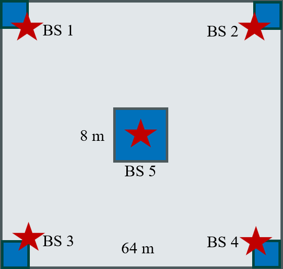

# LWLM: Large Wireless Localization Model

This repository contains the implementation of the paper:  **"Large Wireless Localization Model (LWLM): A Foundation Model for Positioning in 6G Networks."**  

If you have any questions or suggestions, feel free to contact me at **guangjin.pan@chalmers.se**. And also, if you need a model for single-BS positioning test, feel free to contact me too.

Thank you very much for your feedback, it can effectively motivate me and help improve this project.


## 🏋️‍♂️ Contributions
**Hybrid self-supervised learning framework for LWLM:** We propose a novel hybrid SSL pretraining framework for wireless localization tasks that jointly optimizes three objectives: (i) spatial-frequency masked channel modeling (SF-MCM) to capture local and global correlations across antennas and subcarriers, (ii) domain-transformation invariance (DTI) for enforcing consistency across spatial-frequency and angle-delay domains, and (iii) position-invariant contrastive learning (PICL) for capturing robust, location-dependent semantics invariant to BS configurations. While SF-MCM builds upon existing masked modeling techniques, DTI and PICL are newly introduced. This joint learning framework enables the model to acquire diverse, configuration-invariant, and location-aware representations from unlabeled CSI.

**Task-adaptive decoders for downstream localization tasks:** We develop lightweight task-specific decoders for key downstream localization tasks, including ToA estimation, AoA estimation, single-BS localization, and multi-BS fusion. To support an arbitrary number of BSs, the multi-BS decoder extends single-BS models with an attention-based fusion module that adaptively aggregates the location estimates of each BS.




## 🔧 How to Run

### 🏋️‍♂️ Pretraining

To generate the train datasets (include pretraining data and fine-tuning data), run:
```bash
python data_gen_train.py
```

To generate the test datasets, run:
```bash
python data_gen_test.py
```

To pretrain the model, run:

```bash
python train.py \
  --task pretrain_mix \
  --model_path ../../pretrained_model/testmix \
  --is_frozen 0 \
  --is_load 0 \
  --depth 4 \
  --load_pretrained_mdl_path ../../pretrained_model/pretrain_mix/testepoch=139.ckpt
```

### 🎯 Fine-tuning

To fine-tune the pretrained model, run:
```bash
python train.py \
  --task SingleBSLoc \
  --model_path ../../pretrained_model/SingleBSLoc/mix/nofrozen/10000/test2 \
  --is_frozen 0 \
  --is_load 1 \
  --depth 4 \
  --load_pretrained_mdl_path ../../pretrained_model/pretrain_mix/testepoch=139.ckpt \
  --FT_dataset 10000 \
  --BW 10 \
  --pilot_subcarrier_interval 1 \
  --pilot_antenna_interval 1 \
  --BS_Num 4
```

## 📦 Dataset

We use two ray-tracing-based channel datasets to evaluate LWLM.

**DeepMIMO (O1 scenario)**  
- Environment: a typical outdoor urban scenario with two intersecting streets (DeepMIMO-O1).  
- Pretraining: 4 BSs (BS 3, 4, 9, 10), each with a 32-antenna ULA and 128 subcarriers.  
- Bandwidths: 10 MHz, 20 MHz, and 50 MHz.  
- Data coverage: 488,698 UE locations per (BS, bandwidth) setting, yielding a total of $4 \times 3 \times 488{,}698 = 5{,}864{,}376$ channel samples for pretraining.  
- Fine-tuning (default): 10,000 locations for training, 1,000 for validation, and 10,000 for testing.

**Sionna (cross-domain evaluation)**  
- Environment: a different 64 m × 64 m scenario with 5 BSs placed at the four corners and the center (Sionna ray-tracing).  
- System configuration: 10 MHz bandwidth, 32 antennas per BS, and 128 subcarriers.  
- Fine-tuning/testing: 2,000 labeled samples for fine-tuning and 1,000 labeled samples for testing.

### 🗺️ Scenario Illustrations





##  Citation

If you find this work helpful, please consider citing:
```bash
@article{pan2025large,
  title={Large Wireless Localization Model (LWLM): A Foundation Model for Positioning in 6G Networks},
  author={Pan, Guangjin and Huang, Kaixuan and Chen, Hui and Zhang, Shunqing and H{\"a}ger, Christian and Wymeersch, Henk},
  journal={arXiv preprint arXiv:2505.10134},
  year={2025}
}
```

Some other papers:
```bash
@article{pan2025ai,
  title={AI-driven wireless positioning: Fundamentals, standards, state-of-the-art, and challenges},
  author={Pan, Guangjin and Gao, Yuan and Gao, Yilin and Yu, Wenjun and Zhong, Zhiyong and Yang, Xiaoyu and Guo, Xinyu and Xu, Shugong},
  journal={IEEE Communications Surveys \& Tutorials},
  year={2025},
  publisher={IEEE}
}

@article{huang2026retrieval,
  title={A Retrieval-Assisted Framework for Wireless Localization},
  author={Huang, Haoyu and Pan, Guangjin and Huang, Kaixuan and Zhang, Shunqing and Zhang, Yuhao and Keskin, Musa Furkan and Xing, Zheng and Wymeersch, Henk},
  journal={arXiv preprint arXiv:2603.06158},
  year={2026}
}
```
